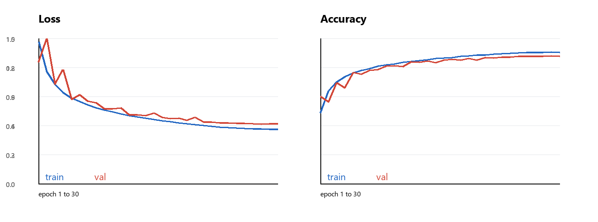
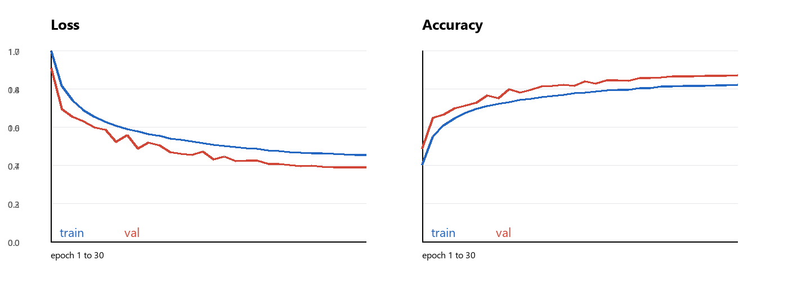
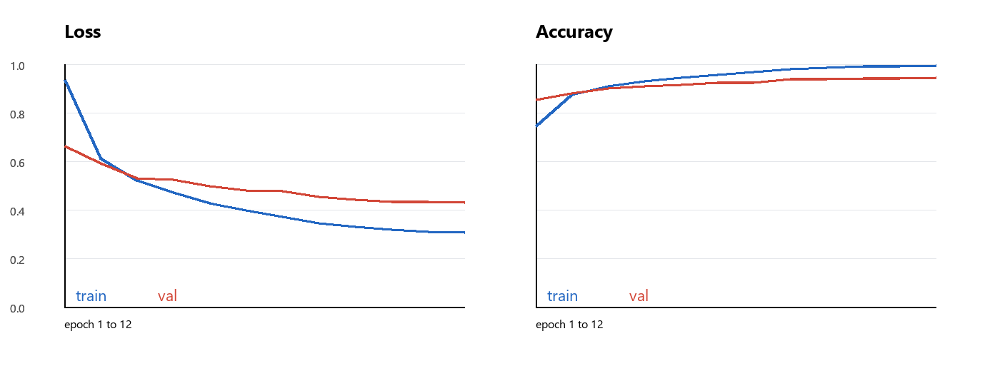
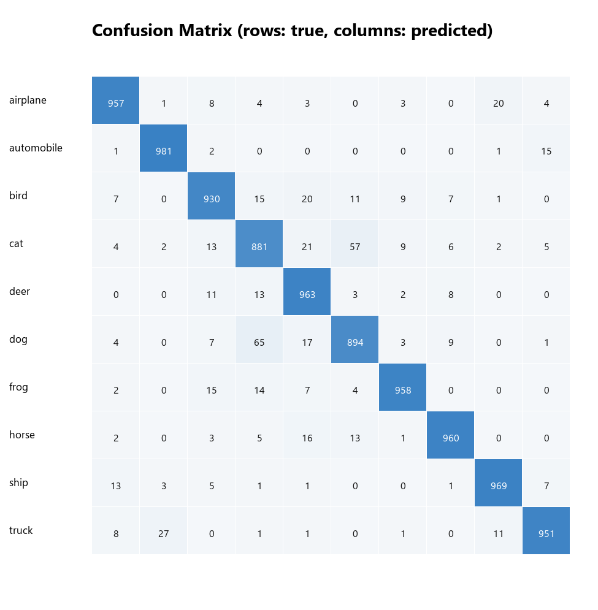
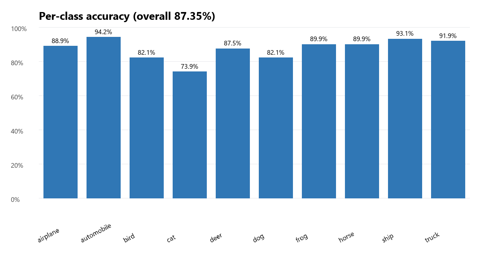
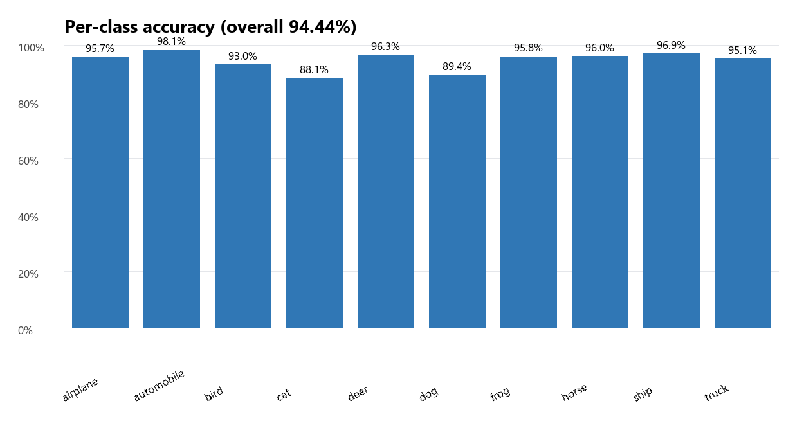
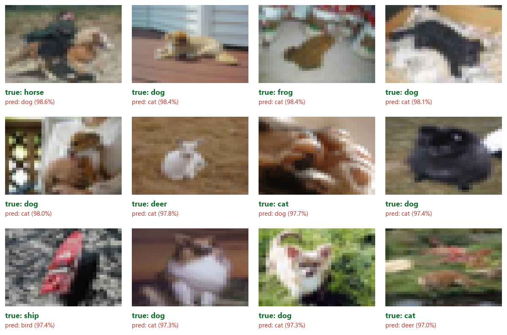
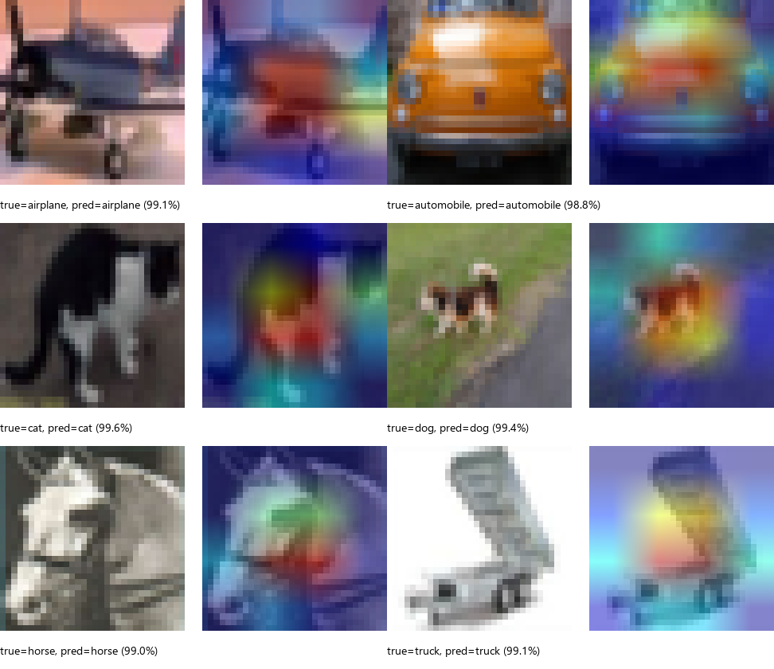

# CIFAR-10 图像分类实验报告

姓名：银启行　学号：10245501485　日期：2026-11-23

## 1. 任务与数据

本实验完成 CIFAR-10 十分类任务。数据集包含 10 类、32×32 彩色图像，每类 5,000 张训练图和 1,000 张测试图。我固定随机种子 42，将官方 50,000 张训练图随机划分为 45,000 张训练集和 5,000 张验证集。训练和模型选择只使用这两个子集，测试集仅在选出验证集最优 checkpoint 后评估。

基础增强包括随机裁剪（padding=4）和随机水平翻转。强增强在此基础上加入 `RandAugment(num_ops=2, magnitude=9)`，并在张量标准化后以 0.25 概率执行随机擦除。所有模型在训练时使用训练增强；验证和测试时只做张量转换与标准化。

实验环境为 Python 3.11、PyTorch 2.14.1、torchvision 0.29.1、NVIDIA GeForce RTX 4060 Laptop GPU，训练 batch size 为 128，使用混合精度。三组正式训练时间合计 2,570.767 秒，约 42.85 分钟。

## 2. 方法

### 2.1 自建 CNN

我自己搭建的 CNN 共有 288,746 个参数。主体由三组模块组成，每组采用两个 3×3 卷积、BatchNorm、ReLU 和 2×2 最大池化，通道数依次为 32、64、128。最后使用全局平均池化、Dropout（0.35）和 128→10 的全连接层。这里用全局平均池化代替大尺寸全连接层，可以减少参数量，也有一定正则化作用；BatchNorm 和 Dropout 分别用于稳定训练和抑制过拟合。

### 2.2 预训练 ResNet18

对比模型采用 ImageNet 预训练 ResNet18，共 11,173,962 个参数。为了适配 CIFAR-10 的 32×32 小图，我把第一个 7×7、步长 2 的卷积改为 3×3、步长 1 的卷积，并去掉紧随其后的最大池化；最后将 512→1000 的分类层替换为 512→10。整个骨干网络参与微调。

### 2.3 训练策略

三组实验统一使用 batch size 128、AdamW、交叉熵损失（label smoothing=0.05）、混合精度和固定种子 42。CNN 初始学习率为 0.001，ResNet18 为 0.0003，权重衰减均为 0.0005。学习率按 CosineAnnealing 衰减到初始值的 1%。CNN 的早停耐心值为 8 个 epoch，ResNet18 为 4 个 epoch，判断依据是验证准确率，并用验证损失处理接近平局的情况。

实验设置如下：

| 实验 | 模型 | 训练增强 | 轮数上限 | 初始学习率 | 早停耐心值 |
| --- | --- | --- | ---: | ---: | ---: |
| `cnn_basic` | 自建 CNN | 裁剪 + 翻转 | 30 | 0.001 | 8 |
| `cnn_strong` | 自建 CNN | 裁剪 + 翻转 + RandAugment + 随机擦除 | 30 | 0.001 | 8 |
| `resnet18` | 预训练 ResNet18 | 裁剪 + 翻转 | 12 | 0.0003 | 4 |

## 3. 实验结果

### 3.1 总览

下表的准确率、损失、最佳轮数和训练时间均来自 `logs/*_train.json` 与 `logs/*_test.json`。

| 实验 | 完成轮数 | 最佳 epoch | 最佳验证损失 | 最佳验证准确率 | 测试准确率 | 训练时间 |
| --- | ---: | ---: | ---: | ---: | ---: | ---: |
| `cnn_basic` | 30 | 29 | 0.6357 | 88.12% | 87.35% | 725.953 秒 |
| `cnn_strong` | 30 | 30 | 0.6662 | 87.12% | 86.54% | 1446.319 秒 |
| `resnet18` | 12 | 12 | 0.4313 | 94.48% | 94.44% | 398.495 秒 |

三组最终的最好测试结果是 ResNet18 的 94.44%，比基础 CNN 的 87.35% 高 7.09 个百分点。三组的早停字段均为 `false`，即到了预设轮数上限时验证指标仍在改善。

基础 CNN 的最佳验证准确率比测试高 0.77 个百分点；强增强模型高 0.58 个百分点；ResNet18 只高 0.04 个百分点。5,000 张验证集给出的模型选择信号与最终测试结果方向一致。

### 3.2 训练曲线



基础 CNN 的训练和验证曲线整体同步上升。第 29 轮取得最佳验证准确率 88.12%，对应训练准确率 90.69%；最后一轮验证准确率回落到 87.90%。训练损失从早期快速下降，最后低于验证损失，但最终差距没有继续明显扩大。



强增强 CNN 在相同 30 轮内最佳验证准确率为 87.12%，低于基础增强的 88.12%。最后一轮训练准确率是 82.34%，验证准确率反而是 87.12%。这个差异不能直接理解为验证集更容易，因为验证阶段没有使用 RandAugment 或随机擦除，训练阶段的输入明显更难；从增强效果看，这个指标差是可解释的。不过从最终测试准确率看，强增强比基础增强低 0.81 个百分点，在本次 30 轮预算下没有带来净收益。

强增强的每轮耗时约 47–49 秒，基础增强约 23–25 秒。RandAugment 与随机擦除的 CPU 开销使训练时间从 725.953 秒增加到 1446.319 秒。



ResNet18 第 1 轮验证准确率已经达到 85.38%，说明预训练特征迁移有效。最后两轮验证准确率分别为 94.36% 和 94.48%。第 12 轮训练准确率为 99.48%，与验证准确率相差 5.00 个百分点，过拟合趋势已经出现；如果继续固定学习率训练，验证指标未必还能同步提高。

### 3.3 混淆矩阵与每类准确率



ResNet18 的测试准确率为 94.44%，对角线上共有 9,444 张图预测正确。最明显的一对混淆是 dog→cat（65 张）和 cat→dog（57 张）；其次为 truck→automobile（27 张）、cat→deer（21 张）、airplane→ship（20 张）以及 bird→deer（20 张）。

每类测试准确率如下，数值来自各组 `*_test.json` 的 `per_class_accuracy`：

| 类别 | 基础 CNN | 强增强 CNN | ResNet18 |
| --- | ---: | ---: | ---: |
| airplane | 88.9% | 90.0% | 95.7% |
| automobile | 94.2% | 93.5% | 98.1% |
| bird | 82.1% | 79.3% | 93.0% |
| cat | 73.9% | 70.6% | 88.1% |
| deer | 87.5% | 87.2% | 96.3% |
| dog | 82.1% | 79.2% | 89.4% |
| frog | 89.9% | 89.4% | 95.8% |
| horse | 89.9% | 89.4% | 96.0% |
| ship | 93.1% | 93.8% | 96.9% |
| truck | 91.9% | 93.0% | 95.1% |

三个模型都把 cat 和 dog 作为最难类别。基础 CNN 的 cat 准确率只有 73.9%，dog 为 82.1%；ResNet18 提高到 88.1% 和 89.4%，但这两个类别仍排在其自身准确率的末两位。ResNet18 最容易的是 automobile（98.1%）和 ship（96.9%）。





### 3.4 误分类样本



错误样本图按模型预测置信度从高到低选取。`resnet18_test.json` 中记录的几个典型例子是：测试索引 1884 的 horse 被判为 dog，置信度 98.58%；索引 5609 的 dog 被判为 cat，置信度 98.41%；索引 59 的 frog 被判为 cat，置信度 98.40%；索引 275 和 8173 的 dog 也被判为 cat，置信度分别为 98.08% 和 98.04%。

这些错误有三个共同点。第一，CIFAR-10 的动物图像只有 32×32，毛发、耳朵和身体轮廓经常被压缩得很模糊。第二，猫和狗都可能呈现坐、卧、趴等姿态，局部纹理和背景也会干扰判断；基础 CNN 的 cat→dog 和 dog→cat 分别有 102 张和 86 张。第三，模型在错误时仍可能给出很高概率，说明只看 softmax 置信度不能可靠发现分布外或少见姿态。

## 4. Grad-CAM

我对 ResNet18 最后一个卷积层 `layer4[-1].conv2` 做 Grad-CAM，将梯度加权后的 4×4 激活图上采样并叠加到原图。六个样本均选自 `logs/resnet18_gradcam.json`，模型全部判对，置信度范围约为 98.76%–99.62%。



飞机样本的热点覆盖机身和机翼区域，汽车样本集中在车身与车头，猫和狗样本主要落在动物身体，卡车样本则覆盖货箱与车体。这说明预训练模型并不只是依赖天空、草地等背景，至少在典型样本上能关注类别相关的物体区域。由于最后特征图只有 4×4，再上采样到 32×32 后边缘较粗糙，这个图更适合观察大致区域，不能当作精确分割结果。

## 5. 反思与改进方向

本次最明确的收益来自预训练特征。ResNet18 只微调 12 轮就达到 94.44%，而自建 CNN 训练 30 轮为 87.35%。这说明在数据量有限、图像分辨率低的任务里，迁移学习比在小数据上完全从零训练更省时间。

强增强没有得到更高测试准确率，我的判断是训练预算不够。它在 30 轮时训练准确率仍只有 82.34%，而验证准确率在低学习率阶段还在缓慢上升；如果延长到更多轮，它可能缩小与基础增强的差距。下一次我会先固定验证集，对 RandAugment 强度和随机擦除概率做小范围消融，而不是同时使用较强参数后再判断。

ResNet18 的训练准确率已达 99.48%，后续可以尝试更强权重衰减、标签平滑、Dropout、MixUp/CutMix，或只微调后几层以控制过拟合。cat/dog 的互相混淆仍然突出，还可以增加针对性难例采样、类别平衡损失，或把相似动物类别合并后再做层次分类。

## 6. 我遇到的问题

第一次在 Windows 上使用 4 个 DataLoader worker 时，每个子进程都会重新载入数据和 PyTorch，启动时间很长且内存占用高。我把 worker 数改为 0，单轮约 22 秒后实验才稳定。强增强虽然可用，但每轮耗时接近基础增强的两倍，这是本次最直接的资源取舍。

另一个问题是强增强的训练准确率和验证准确率不能直接比较，因为两边使用了不同强度的增强。我一开始也容易把它误读为“验证集更简单”，后来在报告中分别说明训练增强和验证预处理。

最后是类别本身的重叠。猫和狗在低分辨率下都可能是带毛发、四条腿的动物，模型会把整块身体或面部纹理作为证据；即使 ResNet18，也无法完全区分。这是数据分辨率和类别语义共同造成的困难。

## 7. 日志与复现

实验结果可用以下命令复现：

```powershell
powershell -ExecutionPolicy Bypass -File .\scripts\run_all.ps1
```

训练配置与逐 epoch 指标见 `logs/cnn_basic_train.json`、`logs/cnn_strong_train.json`、`logs/resnet18_train.json`；测试准确率、混淆矩阵、每类准确率和错误样本索引见对应的 `*_test.json`；Grad-CAM 样本信息见 `logs/resnet18_gradcam.json`。本报告中的实验数字均取自这些 JSON 文件。
